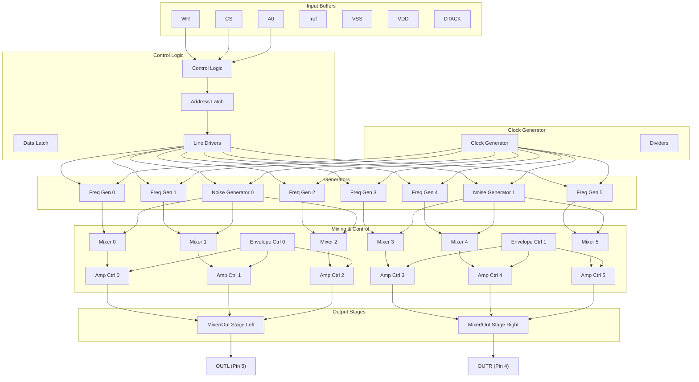
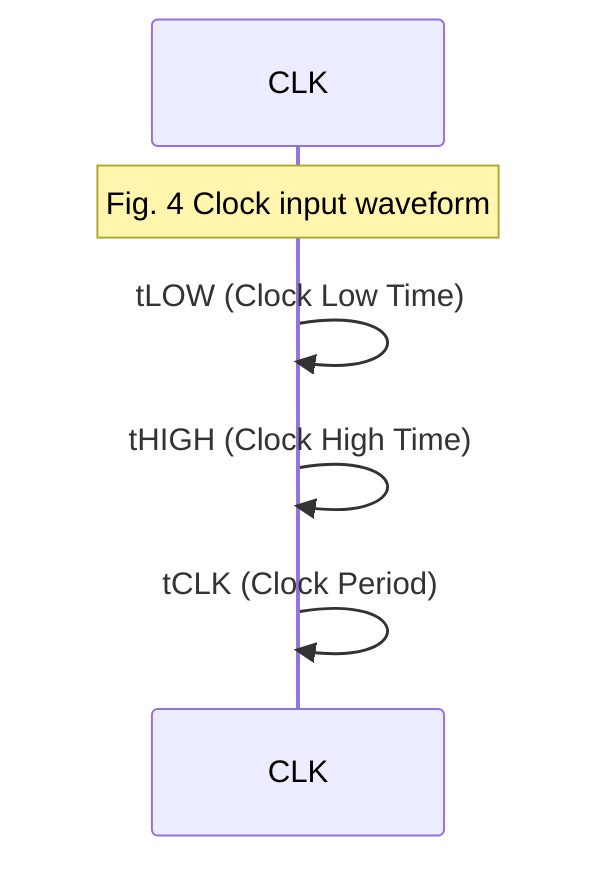
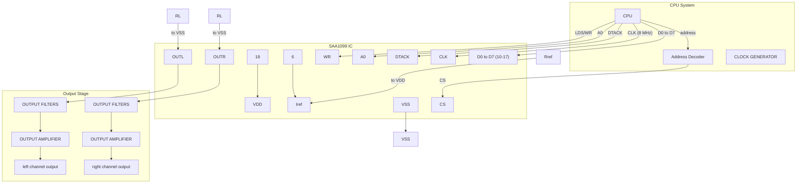

# SAA1099 Datasheet
## Microprocessor Controlled Stereo Sound Generator for Sound Effects and Music Synthesis

**General Description**
The SAA1099 is a monolithic integrated circuit designed for generation of stereo sound effects and music synthesis.

**Features**
* Six frequency generators
  * eight octaves per generator
  * 256 tones per octave
* Two noise generators
* Six noise/frequency mixers
* Twelve amplitude controllers
* Two envelope controllers
* Two 6-channel mixers/current sink analogue output stages
* TTL input compatible
* Readily interfaces to 8-bit microcontroller
* Minimal peripheral components
* Simple output filtering

**Applications**
* Consumer games systems
* Home computers
* Electronic organs
* Arcade games
* Toys
* Chimes/alarm clocks

**Quick Reference Data**
| Parameter | Symbol | Typ | Value |
| :--- | :---: | :---: | :---: |
| Supply voltage (pin 18) | VDD | typ. | 5 V |
| Supply current (pin 18) | IDD | typ. | 70 mA |
| Reference current (pin 6) | Iref | typ. | 250 µA |
| Total power dissipation | Ptot | | 500 mW |
| Operating ambient temperature range | Tamb | | 0 to +70 °C |

**Package Outline**
18-lead DIL; plastic (SOT102).

**Fig. 1 Block Diagram**



**Fig. 2 Pinning Diagram**
```text
1 WR   +------------+   18 VDD
2 CS   |            |   17 D7
3 A0   |  SAA1099   |   16 D6
4 OUTR |            |   15 D5
5 OUTL |            |   14 D4
6 Iref |            |   13 D3
7 DTACK|            |   12 D2
8 CLK  |            |   11 D1
9 VSS  +------------+   10 D0
```

**Pin Designation**
| Pin | Symbol | Description |
|:---:|:---:|:---|
| 1 | $\overline{WR}$ | **Write Enable:** Active LOW input which operates in conjunction with $\overline{CS}$ and A0 to allow writing to the internal registers. |
| 2 | $\overline{CS}$ | **Chip Select:** Active LOW input to identify valid $\overline{WR}$ inputs to the chip. This input also operates in conjunction with $\overline{WR}$ and A0 to allow writing to the internal registers. |
| 3 | A0 | **Control/Address select:** Input used in conjunction with $\overline{WR}$ and $\overline{CS}$ to load data to the control register (A0 = 0) or the address buffer (A0 = 1). |
| 4 | OUTR | **Right channel output:** A 7-level current sink analogue output for the 'right' component. This pin requires an external load resistor. |
| 5 | OUTL | **Left channel output:** A 7-level current sink analogue output for the 'left' component. This pin requires an external load resistor. |
| 6 | $I_{ref}$ | **Reference current supply:** Used to bias the current sink outputs. |
| 7 | $\overline{DTACK}$ | **Data Transfer Acknowledge:** Open drain output, active LOW to acknowledge successful data transfer. On completion of the cycle $\overline{DTACK}$ is set to inactive. |
| 8 | CLK | **Clock:** Input for an externally generated clock at a nominal frequency of 8 MHz. |
| 9 | VSS | **Ground:** 0 V. |
| 10-17 | D0-D7 | **Data:** Data bus input. |
| 18 | VDD | **Power supply:** +5 V typical. |

**Frequency generators**
Six frequency generators can each select one of 8 octaves and one of 256 tones within an octave. A total frequency range of 31 Hz to 7.81 kHz is available. The outputs may also control noise or envelope generators. All frequency generators have an enable bit which switches them on and off, making it possible to preselect a tone and to make it inaudible when required. The frequency generators may be synchronized using the frequency reset bit.

**The frequency ranges per octave are:**
| Octave | Frequency range |
|:---:|:---|
| 0 | 31 Hz to 61 Hz |
| 1 | 61 Hz to 122 Hz |
| 2 | 122 Hz to 244 Hz |
| 3 | 245 Hz to 488 Hz |
| 4 | 489 Hz to 977 Hz |
| 5 | 978 Hz to 1.95 kHz |
| 6 | 1.96 kHz to 3.91 kHz |
| 7 | 3.91 kHz to 7.81 kHz |

**Noise generators**
The two noise generators both have a programmable output. This may be a software controlled noise via one of the frequency controlled generators or one of three pre-defined noisies. There is no tone produced by the frequency generator when it is controlling the noise generator. The noise produced is based on double the frequency generator output, i.e. a range of 61 Hz to 15.6 kHz.

In the event of a pre-defined noise being chosen, the output of noise generator 0 can be mixed with frequency generator 0, 1 and 2; and the output of noise generator 1 can be mixed with frequency generator 3, 4 and 5. In order to produce an equal level of noise and tone outputs (when both are mixed) the amplitude of the tone is increased. The three pre-defined noises are based on a clock frequency of 7.8 kHz, 15.6 kHz or 31.25 kHz.

**Noise/frequency mixers**
Six noise/frequency mixers each with four selections:
* Channel off
* Frequency only
* Noise only
* Noise and frequency

Each mixer channel has one of the frequency generator outputs fed to it, three channels use noise generator 0 and the other three use noise generator 1.

**Amplitude controllers**
Each of the six channel outputs from the mixer is split up into a right and left component giving effectively twelve amplitude controllers. An amplitude of 16 possible levels is assigned to each of the twelve signals. With this configuration a stereo effect can be achieved by varying only the amplitude component. The moving of a sound from one channel to the other requires, per tone, only one update of the amplitude register contents.

When an envelope generator is used, the amplitude levels are restricted. The number of levels available is then reduced to eight. This is achieved by disabling the least significant bit (LSB) of the amplitude control.

**Envelope controllers**
Two of the six tone generators are under envelope control. This applies to both the left and right outputs from the tone generator.
The envelope has the following eight possible modes:
* Amplitude is zero
* Single attack
* Single decay
* Single attack-decay (triangular)
* Maximum amplitude
* Continuous attack
* Continuous decay
* Continuous attack-decay

The timing of the envelope controllers is programmable using one of the frequency generators (see Fig. 1). When the envelope mode is selected for a channel its control resolution is halved for that channel from 16 levels to 8 levels by rounding down to the nearest even level.

There is also the capability of controlling the 'right' component of the channel with inverse of the 'left' component, which remains as programmed.

A direct enable permits the start of an envelope to be defined, and also allows termination of an envelope at any time. The envelope rate may be controlled by a frequency channel (see Fig. 1), or by the microprocessor writing to the address buffer register. If the frequency channel controlled is OFF (NE = FE = 0) the envelope will appear at the output, which provides an alternative 'non-square' tone capability. In this event the frequency will be the envelope rate, which provided the rate is from the frequency channel, will be a maximum of 1 kHz. Higher frequencies of up to 2 kHz can be obtained by the envelope resolution being halved from 16 levels to 8 levels. Rates quoted are based on the input of a 8 MHz clock.

**Six-channel mixers/current sink analogue output stages**
Six channels are mixed together by the two mixers allowing each one to control one of six equally weighted current sinks, to provide a seven level analogue output.

**Command/control select**
In order to simplify the microprocessor interface the command and control information is multiplexed. To select a register in order to control frequencies, amplitudes, etc. the command-register has to be loaded. The contents of this register determines to which register the data is written in the next control-cycle. If a continuous update of the control-register is necessary, only the control-information has to be written (the command-information does not change).

If the command/control select (A0) is logic 0, the byte transfer is control; if A0 is logic 1, the byte transfer is command.

**Interface to microprocessor**
The SAA1099 is a data bus based I/O peripheral. Depending on the value of the command/control signal (A0) the $\overline{CS}$ and $\overline{WR}$ signals control the data transfer from the microprocessor to the SAA1099. The data-transfer-acknowledge ($\overline{DTACK}$) indicates that the data transfer is completed. When, during the write cycle, the microprocessor recognizes the $\overline{DTACK}$, the bus cycle will be completed by the processor.

**Ratings**
Limiting values in accordance with the Absolute Maximum System (IEC 134)

| Parameter | Symbol | Min | Max | Unit |
| :--- | :---: | :---: | :---: | :---: |
| Supply voltage (pin 18) | $V_{DD}$ | -0.3 | +7.5 | V |
| Maximum input voltage | $V_I$ | -0.3 | +7.5 | V |
| &nbsp;&nbsp;*at $V_{DD}$ = 4.5 to 5.5 V* | $V_I$ | -0.5 | +7.5 | V |
| Maximum output current | $I_O$ | - | 10 | mA |
| Total power dissipation | $P_{tot}$ | - | 500 | mW |
| Storage temperature range | $T_{stg}$ | -55 | +125 | °C |
| Operating ambient temperature range | $T_{amb}$ | 0 | +70 | °C |
| Electrostatic handling* | $V_{es}$ | -1000 | +1000 | V |

\* Equivalent to discharging a 250 $\mu$F capacitor through a 1 k$\Omega$ series resistor.

**D.C. Characteristics**
$V_{DD}$ = 5 V $\pm$ 10%; $T_{amb}$ = 0 to 70 °C; unless otherwise specified

| Parameter | Symbol | Min | Typ | Max | Unit |
| :--- | :---: | :---: | :---: | :---: | :---: |
| **Supply** | | | | | |
| Supply voltage | $V_{DD}$ | 4.5 | 5.0 | 5.5 | V |
| Supply current | $I_{DD}$ | - | 70 | 100 | mA |
| Reference current (note 1) | $I_{ref}$ | 100 | 250 | 400 | $\mu$A |
| **INPUTS** | | | | | |
| Input voltage HIGH | $V_{IH}$ | 2.0 | - | 6.0 | V |
| Input voltage LOW | $V_{IL}$ | -0.5 | - | 0.8 | V |
| Input leakage current | $\pm I_{LI}$ | - | - | 10 | $\mu$A |
| Input capacitance | $C_I$ | - | - | 10 | pF |
| **OUTPUTS** | | | | | |
| $\overline{DTACK}$ (open drain; note 2) | | | | | |
| Output voltage LOW at $I_{OL}$ = 3.2 mA | $V_{OL}$ | 0 | - | 0.4 | V |
| Voltage on pin 7 (OFF state) | $V_{7-9}$ | -0.3 | - | 6.0 | V |
| Output capacitance (OFF state) | $C_O$ | - | - | 10 | pF |
| Load capacitance | $C_L$ | - | - | 150 | pF |
| Output leakage current (OFF state) | $-I_{LO}$ | - | - | 10 | $\mu$A |
| **Audio outputs (pins 4 and 5)** | | | | | |
| *With fixed $I_{ref}$ (note 3)* | | | | | |
| One channel on | $I_{01}/I_{ref}$ | 90 | - | 120 | % |
| Six channels on | $I_{06}/6 \times I_{ref}$ | 85 | - | 110 | % |
| *With $I_{ref}$ = 250 $\mu$A; $R_L$ = 1.5 k$\Omega$ ($\pm$ 5%)* | | | | | |
| One channel on | $I_{01}/I_{ref}$ | 90 | - | 110 | % |
| Six channels on | $I_{06}/6 \times I_{ref}$ | 85 | - | 105 | % |
| Output current one channel on | $I_{01}$ | 225 | - | 275 | $\mu$A |
| Output current six channels on | $I_{06}$ | 1.3 | - | 1.6 | mA |
| *With resistor supplying $I_{ref}$ (note 4)* | | | | | |
| Output current one channel on | $I_{01}$ | 150 | - | 350 | $\mu$A |
| Output current six channels on | $I_{06}$ | 0.9 | - | 1.9 | mA |
| Load resistance | $R_L$ | 600 | - | - | $\Omega$ |
| D.C. leakage current all channels off | $-I_{LO}$ | - | - | 10 | $\mu$A |
| Maximum current difference between left and right current sinks (note 5) | $\pm I_{Omax}$ | - | - | 15 | % |
| Signal-to-noise ratio (note 6) | S/N | - | tbf | - | dB |

**A.C. Characteristics**
$V_{DD}$ = 5 V $\pm$ 10%; $T_{amb}$ = 0 to 70 °C; timing measurements taken at 2.0 V for a logic 1 and 0.8 V for a logic 0 unless otherwise specified (see waveforms Figs 3 and 4)

| parameter | symbol | min. | typ. | max. | unit |
| :--- | :---: | :---: | :---: | :---: | :---: |
| **Bus interface timing (see Fig. 3)** | | | | | |
| A0 set-up time to $\overline{CS}$ fall | $t_{ASC}$ | 0 | - | - | ns |
| $\overline{CS}$ LOW to $\overline{WR}$ fall | $t_{CSW}$ | 30 | - | - | ns |
| A0 set-up time to $\overline{WR}$ fall | $t_{ASW}$ | 50 | - | - | ns |
| $\overline{WR}$ LOW time | $t_{WL}$ | 100 | - | - | ns |
| Data bus valid to $\overline{WR}$ rise | $t_{BSW}$ | 100 | - | - | ns |
| $\overline{DTACK}$ fall delay from $\overline{WR}$ fall (note 7) | $t_{DFW}$ | 0 | - | 85 | ns |
| A0 hold time from $\overline{WR}$ HIGH | $t_{AHW}$ | 0 | - | - | ns |
| $\overline{CS}$ hold time from $\overline{WR}$ HIGH | $t_{CHW}$ | 0 | - | - | ns |
| Data bus hold time from $\overline{WR}$ HIGH | $t_{DHW}$ | 0 | - | - | ns |
| $\overline{DTACK}$ rise delay from $\overline{WR}$ HIGH | $t_{DRW}$ | 0 | - | 100 | ns |
| Bus cycle time (note 8) | $t_{CY}$ | 4$t_{CLK}$ | - | - | |
| Bus cycle time (note 9) | $t_{CY}$ | 16$t_{CLK}$ | - | - | |
| **Clock input timing (see Fig. 4)** | | | | | |
| Clock period | $t_{CLK}$ | 120 | 125 | 255 | ns |
| Clock LOW time | $t_{LOW}$ | 55 | - | - | ns |
| Clock HIGH time | $t_{HIGH}$ | 55 | - | - | ns |

**Notes to the characteristics**
1. Using an external constant current generator to provide a nominal $I_{ref}$ or external resistor connected to $V_{DD}$.
2. This output is short-circuit protected to $V_{DD}$ and $V_{SS}$.
3. Measured with $I_{ref}$ a constant value between 100 and 400 $\mu$A; load resistance ($R_L$) allowed to match E12 (5%) in all applications via:
   $$R_L = 0.6 [I_{ref}]^{-1} - 16 [I_{ref}]^{-0.5} \pm 12\%$$
4. Measured with $R_{ref}$ = 10 k$\Omega$ ($\pm$ 5%) connected between $I_{ref}$ and $V_{DD}$; $R_L$ = 1.5 k$\Omega$ ($\pm$ 5%); OUTR and OUTL short-circuit protected to $V_{SS}$.
5. Left and right outputs must be driven with identical configuration.
6. Sample tested value only.
7. This timing parameter only applies when no wait states are required; otherwise parameter is invalid.
8. The minimum bus cycle time of four clock periods is for loading all registers except the amplitude registers.
9. The minimum bus cycle time of 16 clock periods is for loading the amplitude registers. In a system using $\overline{DTACK}$ it is possible to achieve minimum times of 500 ns. Without $\overline{DTACK}$ the parameter given must be used.

**Fig. 3 Bus Interface Waveforms**
```mermaid
sequenceDiagram
    participant A0
    participant CS
    participant WR
    participant D0_D7
    participant DTACK

    Note over A0, CS, WR, D0_D7, DTACK: Fig. 3 Bus interface waveforms

    A0->>CS: tASC (Address Setup)
    CS->>CS: tCSW (Chip Select Width)
    CS->>WR: tASW (Address Setup Width)
    WR->>WR: tWL (Write Pulse Width)
    WR->>D0_D7: tBSW (Bus Setup Width)
    D0_D7->>D0_D7: tDHW (Data Hold Width)
    D0_D7->>DTACK: tDFW (Data Setup Width)
    DTACK->>DTACK: tDRW (Data Hold Width)
    A0->>A0: tAHW (Address Hold Width)
    CS->>CS: tCHW (Chip Select Hold Width)
```

**Fig. 4 Clock Input Waveform**


**Application Information**
**Device operation**
The SAA1099 uses pulse width modulation to achieve amplitude and envelope levels. The twelve signals are mixed in an analogue format (6 'left' and 6 'right') before leaving the chip. The amplitude and envelope signals chop the output at a minimum rate of 62.5 kHz, compared with the highest tone output of 7.81 kHz. Simple external low-pass filtering is used to remove the high frequency components. Rates quoted are based on the input of a 8 MHz clock.

A data bus based write only structure is used to load the on-board registers. The data bus is used to load the address for a register, and subsequently the data to that register. Once the address is loaded multiple data loads to that register can be performed.

The selection of address or data is made by the single address bit A0, as shown in register maps Table 1 and Table 2.

The bus control signals $\overline{WR}$ and $\overline{CS}$ are designed to be compatible with a wide range of microprocessors, a $\overline{DTACK}$ output is included to optimise the interface with an S68000 series microprocessor. In most bus cycles $\overline{DTACK}$ will be returned immediately, this applies to all register address load cycles and all except amplitude data load cycles. With respect to amplitude data, a number of wait cycles may need to be performed, depending on the time since the previous amplitude load. $\overline{DTACK}$ will indicate the number of required waits.

**Register description (see Tables 2 and 3)**
The amplitudes are assigned with 'left' and 'right' components in the same byte, on a channel by channel basis. The spare locations that are left between blocks of registers is to allow for future expansion, and should be written as zero's. The tone within an octave is defined by eight bits and the octave by three bits. Note that octaves are paired (0/1, 2/3 etc.). The frequency and noise enables are grouped together for ease of programming. The controls for noise 'colour' (clock rate) are grouped in one byte.

The envelope registers are positioned in adjacent locations. There are two types of envelope controls, direct acting controls and buffered controls. The direct acting controls always take immediate effect, and are:
* Envelope enable (reset)
* Envelope resolution (16/8 level)

The buffered controls are acted upon only at the times shown in Fig. 5 and control selection of:
* Envelope clock source
* Waveform type
* Inverted/non-inverted 'right' component

**Table 1 External memory map**
| select A0 | D7 | D6 | D5 | D4 | D3 | D2 | D1 | D0 | operations |
| :---: | :---: | :---: | :---: | :---: | :---: | :---: | :---: | :---: | :--- |
| **0** | D7 | D6 | D5 | D4 | D3 | D2 | D1 | D0 | data for internal registers |
| **1** | X | X | X | A4 | A3 | A2 | A1 | A0 | internal register address |

*Where X = don't care state.*

**Table 2 Internal register map**
| register address | D7 | D6 | D5 | D4 | D3 | D2 | D1 | D0 | operations |
| :--- | :---: | :---: | :---: | :---: | :---: | :---: | :---: | :---: | :--- |
| **00** | AR03 | AR02 | AR01 | AR00 | AL03 | AL02 | AL01 | AL00 | amplitude 0 right channel; left channel |
| **01** | 1 | 1 | 1 | 1 | 1 | 1 | 1 | 1 | amplitude 1 right/left |
| **02** | 2 | 2 | 2 | 2 | 2 | 2 | 2 | 2 | amplitude 2 right/left |
| **03** | 3 | 3 | 3 | 3 | 3 | 3 | 3 | 3 | amplitude 3 right/left |
| **04** | 4 | 4 | 4 | 4 | 4 | 4 | 4 | 4 | amplitude 4 right/left |
| **05** | 5 | 5 | 5 | 5 | 5 | 5 | 5 | 5 | amplitude 5 right/left |
| **06** | X | X | X | X | X | X | X | X | |
| **07** | X | X | X | X | X | X | X | X | |
| **08** | F07 | F06 | F05 | F04 | F03 | F02 | F01 | F00 | frequency of tone 0 |
| **09** | 1 | 1 | 1 | 1 | 1 | 1 | 1 | 1 | frequency of tone 1 |
| **0A** | 2 | 2 | 2 | 2 | 2 | 2 | 2 | 2 | frequency of tone 2 |
| **0B** | 3 | 3 | 3 | 3 | 3 | 3 | 3 | 3 | frequency of tone 3 |
| **0C** | 4 | 4 | 4 | 4 | 4 | 4 | 4 | 4 | frequency of tone 4 |
| **0D** | F57 | F56 | F55 | F54 | F53 | F52 | F51 | F50 | frequency of tone 5 |
| **0E** | X | X | X | X | X | X | X | X | |
| **0F** | X | X | X | X | X | X | X | X | |
| **10** | X | 012 | 011 | 010 | X | 002 | 001 | 000 | octave 1; octave 0 |
| **11** | X | 032 | 031 | 030 | X | 022 | 021 | 020 | octave 3; octave 2 |
| **12** | X | 052 | 051 | 050 | X | 042 | 041 | 040 | octave 5; octave 4 |
| **13** | X | X | X | X | X | X | X | X | |
| **14** | X | X | FE5 | FE4 | FE3 | FE2 | FE1 | FE0 | frequency enable |
| **15** | X | X | NE5 | NE4 | NE3 | NE2 | NE1 | NE0 | noise enable |
| **16** | X | X | N11 | N10 | X | X | N01 | N00 | noise generator 1; noise generator 0 |
| **17** | X | X | X | X | X | X | X | X | |
| **18** | E07 | X | E05 | E04 | E03 | E02 | E01 | E00 | envelope generator 0 |
| **19** | E17 | X | E15 | E14 | E13 | E12 | E11 | E10 | envelope generator 1 |
| **1A** | X | X | X | X | X | X | X | X | |
| **1B** | X | X | X | X | X | X | X | X | |
| **1C** | X | X | X | X | X | X | RST | SE | frequency reset (all channels) sound enable (all channels) |
| **1D** | X | X | X | X | X | X | X | X | |
| **1E** | X | X | X | X | X | X | X | X | |
| **1F** | X | X | X | X | X | X | X | X | |

**Where:**
* All don't cares (X) should be written as zero's.
* 00 to 1F block of registers repeats eight times in the block between addresses 00 to FF (full internal memory map).

**Table 3 Register description**

| bit | description |
| :--- | :--- |
| **ARn3; ARn2; ARn1; ARn0**<br>(n = 0,5) | **4 bits for amplitude control of right channel**<br>0 0 0 0 minimum amplitude (off)<br>1 1 1 1 maximum amplitude |
| **ALn3; ALn2; ALn1; ALn0**<br>(n = 0,5) | **4 bits for amplitude control of left channel**<br>0 0 0 0 minimum amplitude (off)<br>1 1 1 1 maximum amplitude |
| **Fn7 to Fn0**<br>(n = 0,5) | **8 bits for frequency control of the six frequency generators**<br>0 0 0 0 0 0 0 0 lowest frequency<br>1 1 1 1 1 1 1 1 highest frequency |
| **On2; On1; On0**<br>(n = 0,5) | **3 bits for octave control**<br>0 0 0 lowest octave (31 Hz to 61 Hz)<br>0 0 1 (61 Hz to 122 Hz)<br>0 1 0 (122 Hz to 244 Hz)<br>0 1 1 (245 Hz to 488 Hz)<br>1 0 0 (489 Hz to 977 Hz)<br>1 0 1 (978 Hz to 1.95 kHz)<br>1 1 0 (1.96 kHz to 3.91 kHz)<br>1 1 1 highest octave (3.91 kHz to 7.81 kHz) |
| **FEn**<br>(n = 0,5) | **frequency enable bit (one tone per generator)**<br>FEn = 0 indicates that frequency 'n' is off |
| **NEn**<br>(n = 0,5) | **noise enable bit (one tone per generator)**<br>NEn = 0 indicates that noise 'n' is off |
| **Nn1; Nn0**<br>(n = 0,1) | **2 bits for noise generator control.**<br>These bits select the noise generator rate (noise 'colour')<br><br>| Nn1 | Nn0 | clock frequency |<br>| :---: | :---: | :--- |<br>| 0 | 0 | 31.3 kHz |<br>| 0 | 1 | 15.6 kHz |<br>| 1 | 0 | 7.6 kHz |<br>| 1 | 1 | 61 Hz to 15.6 kHz (frequency generator 0/3) |
| **En7; En5 to En0**<br>(n = 0,1) | **7 bits for envelope control**<br><br>**En0**<br>0 left and right component have the same envelope<br>1 right component has inverse of envelope that is applied to left component<br><br>**En3 En2 En1**<br>0 0 0 zero amplitude<br>0 0 1 maximum amplitude<br>0 1 0 single decay<br>0 1 1 repetitive decay<br>1 0 0 single triangular<br>1 0 1 repetitive triangular<br>1 1 0 single attack<br>1 1 1 repetitive attack<br><br>**En4**<br>0 4 bits for envelope control (maximum frequency = 977 Hz)<br>1 3 bits for envelope control (maximum frequency = 1.95 kHz)<br><br>**En5**<br>0 internal envelope clock (frequency generator 1 or 4)<br>1 external envelope clock (address write pulse)<br><br>**En7**<br>0 reset (no envelope control)<br>1 envelope control enabled |
| **SE** | **SE sound enable for all channels**<br>(reset on power-up to 0)<br>0 all channels disabled<br>1 all channels enabled |
| **RST** | **Reset signal to all frequency generators**<br>0 all generators enabled<br>1 all generators reset and synchronized |

**Note**
All rates given are based on the input of a 8 MHz clock.

**Fig. 5 Envelope waveforms**

This figure illustrates the output waveforms based on the Envelope Control bits (En3, En2, En1, En0).

| En3 | En2 | En1 | En0 | Waveform Type | Description |
|:---:|:---:|:---:|:---:| :--- | :--- |
| 0 | 0 | 0 | 0 | **Zero Amplitude** | (a) Output is zero (inactive) |
| 0 | 0 | 1 | 0 | **Maximum Amplitude** | (b) Output is constant max level |
| 0 | 1 | 0 | 0 | **Single Decay** | (c) Attack then single decay |
| 0 | 1 | 1 | 0 | **Repetitive Decay** | (d) Attack then repetitive decay |
| 1 | 0 | 0 | 0 | **Single Triangular** | (e) Single triangle wave |
| 1 | 0 | 1 | 0 | **Repetitive Triangular** | (f) Continuous triangle wave |
| 1 | 1 | 0 | 0 | **Single Attack** | (g) Single attack ramp |
| 1 | 1 | 1 | 0 | **Repetitive Attack** | (h) Continuous attack ramp |
| 1 | 1 | 1 | 1 | **Inverse Envelope** | (i) Right channel inverse of left (En0=1) |

**Notes to Fig. 5**
(1) The level at this time is under amplitude control only (En7 = 0; no envelope).
(2) When the generator is active (En7 = 1) the maximum level possible is 7/8ths of the amplitude level.
(3) After position (3) the buffered controls will be acted upon when loaded.
(4) At positions (4) the buffered controls will be acted upon if already loaded.
(5) Waveforms 'a' to 'h' show the left channel (En0 = 0; left and right components have the same envelope).
    Waveform 'i' shows the right channel (En0 = 1; right component inverse of envelope applied to left).

**Fig. 6 Typical application circuit diagram**

